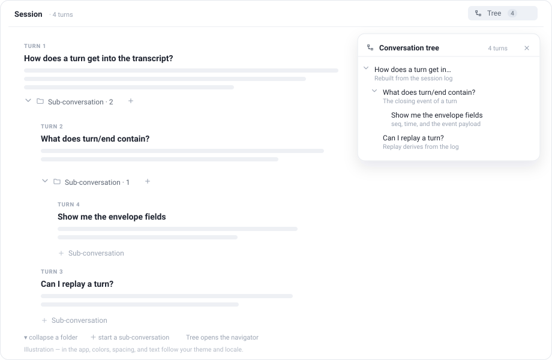

<h1 align="center">
  <br>
  dsh-inline-branches
</h1>

<p align="center"><strong>把对话轮次变成嵌套文件夹，并提供一棵可跳转的对话树 —— 像 Finder 一样展开/收起，不新建 Session。</strong></p>

<p align="center">
  <a href="./README.md">English</a> ·
  <a href="#安装">安装</a> ·
  <a href="#使用">使用</a> ·
  <a href="#实现方式">实现方式</a> ·
  <a href="#已知限制">已知限制</a>
</p>

<p align="center"></p>



> 示意图。实际界面里的颜色、间距和文字会跟随你的主题和语言。

## 为什么

Harness 的对话记录是一条平铺的时间线：追问总是落在同一个线程里，想展开一个支线问题时，通常只好另开一个 Session。这个插件走轻量路线 —— 任何已完成的轮次都可以拥有子对话，并在同一个对话里以文件夹形式呈现。

父子关系只是浏览器里的**展示层**数据，不是 fork。轮次、消息、工具卡片、审批和会话日志都保持原样。

## 功能

- **轮次文件夹** —— 每个完成的轮次下方有「＋ 子对话」；有子轮次后变成带展开箭头的「子对话 · N」。
- **任意层级嵌套** —— 点「＋ 子对话」进入该文件夹，之后在主输入框继续提问，新轮次逐层嵌套。
- **Finder 式折叠** —— 收起一个文件夹即隐藏它的整棵子树，展开即恢复。
- **对话树导航** —— 标题栏的 **对话树** 按钮打开整棵树的列表；点任意一行跳到对应轮次，折叠状态与主对话共享。
- **原生渲染** —— 消息、Markdown、工具卡片、审批、图片仍由原生 Chat 渲染，没有重写一套消息 UI。
- **跟随主题与语言** —— 使用 `--dsw-alias-*` 主题变量，内置中英文文案。

## 环境要求

- 带 Web UI 的 DeepSeek Harness Desktop，针对 **0.2.1-rc.3** 开发。
- 无构建步骤、无运行时依赖、无网络请求。

## 安装

### 在 Web UI 中

1. 在侧边栏打开 **Plugins**。
2. 点 **Add plugin**。
3. 粘贴仓库地址，或本地目录的绝对路径，确认安装。

安装器会把 `dsh-inline-branches` 加入当前 profile 并默认启用。

### 用命令行

```bash
git clone https://github.com/<your-username>/dsh-inline-branches.git
dsh plugin --profile desktop add "$PWD/dsh-inline-branches"
```

也可以直接从仓库安装：

```bash
dsh plugin --profile desktop add https://github.com/<your-username>/dsh-inline-branches
```

如果你用的不是 `desktop` profile，替换成实际名称。安装默认会启用这个 bundle；如果标题栏没有出现 **对话树**，重启 Harness。

本插件没有发布到 npm，请从本仓库安装。

## 使用

1. 完成一轮对话，该轮下方会出现「＋ 子对话」。
2. 点它进入该轮的子对话：输入框上方出现提示条，说明新消息会进入「该轮问题」的子对话。
3. 直接在**主输入框**里继续提问。新轮次会挂到该轮下面，并按层级缩进；只要还停留在该文件夹里，后续轮次都会继续嵌套。
4. 点文件夹行左侧的箭头，可以展开/收起它的整棵子树；收起时子轮次从主对话中隐藏。
5. 想更深一层：点某个**子轮次**自己的「＋ 子对话」。
6. 想回到顶层：点提示条里的 **返回主线**。
7. 点标题栏的 **对话树** 打开导航：每行按层级缩进，显示问题和最新回答的摘要，点击跳到对应轮次；这里的箭头和主对话共享折叠状态。

## 实现方式

整棵「树」都是客户端对现有会话的一层展示：

| 部分 | 机制 |
|---|---|
| 父子关系 | `localStorage` 键 `dsh.inline-tree.v3` —— `{ [sessionId]: { parents: { [轮次]: 父轮次 } } }` |
| 折叠状态 | `localStorage` 键 `dsh.inline-tree.collapsed.v1` |
| 排序与缩进 | 每个会话注入一段 `<style>`：按树的先序给每个 `[data-chat-turn]` 设置 `order`，按深度设置 `margin-left`；祖先被收起时设为 `display: none` |
| 渲染层 | 原生 Chat 的 flow 槽位是 `display: contents`，因此轮次就是对话列的 flex 项 |
| 入口 | Client 槽位：`conversation.session.header.actions`（对话树按钮）、`conversation.chat.turnTail`（文件夹行）、`conversation.input.dock`（进入子对话的提示条）、`shell.overlay`（导航面板） |
| Host 侧 | `index.js` 只导出一个空的 `apply()`；bundle patch 需要一行 Host 入口，但没有任何 Host 逻辑 |

进入某个子对话后，标题栏组件会监听会话的轮次列表，把新出现的轮次记到当前文件夹下 —— 所以不需要 fork 或新 Session。父子关系存在浏览器里，因此只对当前浏览器生效：会话日志仍是线性的，换设备或清除站点数据后，轮次还在，树不跟随。

插件还会按内置中英文的 `aria-label` 隐藏原生 **在新对话中分支** 按钮，避免两种分支模型混淆。

## 数据与隐私

- 只在浏览器 `localStorage` 里保存轮次编号和父轮次编号。
- 不写会话日志，也不发网络请求。
- 清除站点数据会丢失树的布局，轮次本身不受影响。

## 兼容性

树是纯 CSS 叠加在 Chat DOM 上的，因此依赖当前 DSH 版本的一些实现细节：

- 轮次元素上的 `data-chat-turn`；
- Chat flow 槽位为 `display: contents`，轮次因此是 flex 项；
- running/older 行的 `tnXGgG_*` class 名；
- 上面列出的槽位名，以及原生分支按钮的本地化 `aria-label`。

如果 DSH 升级改掉这些，嵌套可能失效，需要等插件适配。插件不改会话数据，欢迎提 PR 适配新版本。

## 已知限制

- **没有上下文隔离。** 子对话只是追加在当前会话里的普通轮次，模型按时间顺序看到它们，而不是拼在父轮次处。这是「不新建 Session」的代价。
- **只是展示层。** 父子关系存在浏览器里，会话日志仍是线性的，换设备不跟随。
- **轮次编号仍是线性的。** 子轮次保留自己的轮次编号，也会作为普通轮次出现在上下文里。
- **只列已加载的轮次。** 导航树只显示当前已加载的轮次；更早的轮次需要先让主对话加载。
- **「已进入的文件夹」只在内存里。** 刷新页面后会回到主线。
- **原生分支按钮被隐藏。** 内置的「在新对话中分支」被隐藏，避免和子对话混淆。

## 卸载

- 在 **Plugins** 里移除，或运行 `dsh plugin --profile desktop remove dsh-inline-branches`。
- 可选：清除 Web UI origin 下的 `dsh.inline-tree.v3` 和 `dsh.inline-tree.collapsed.v1`。

## 开发

插件是纯 JavaScript，由 Client 模块加载器直接加载 —— 没有打包步骤，也没有依赖。

```
client.js           全部 UI：store、树模型、注入的 CSS、React 组件
index.js            Host 侧：空的 apply()
cordis.patch.yml    插入 inline-branches 行的 bundle patch
locale/en.json      Plugin Manager 元数据（标题/描述）
locale/zh.json
icon.svg            Plugin Manager 图标
docs/preview.svg    README 示意图
```

用 **Add plugin → 本地路径** 把一个 profile 指向这个目录；修改 `client.js` 后重启或重新安装，以加载新的 Client 模块。

## License

[MIT](./LICENSE)

与 DeepSeek 官方无关；「DeepSeek Harness」仅用于说明兼容性。
